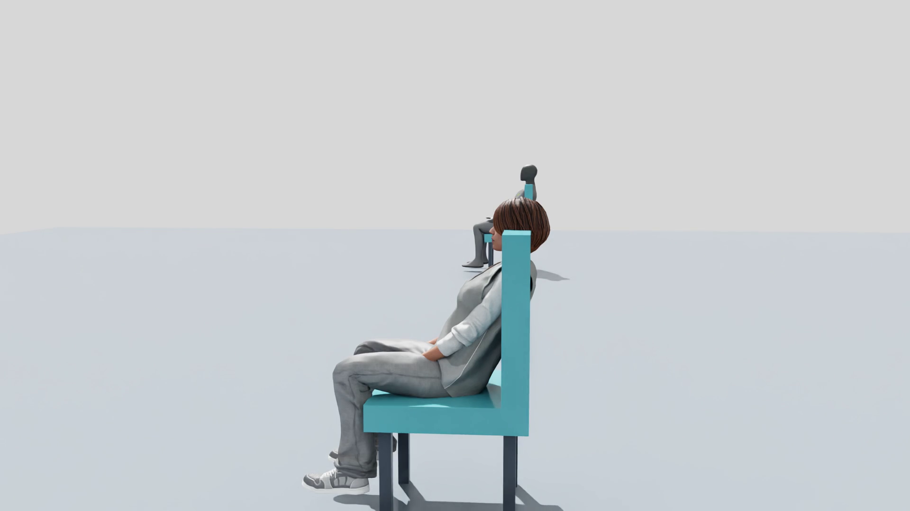
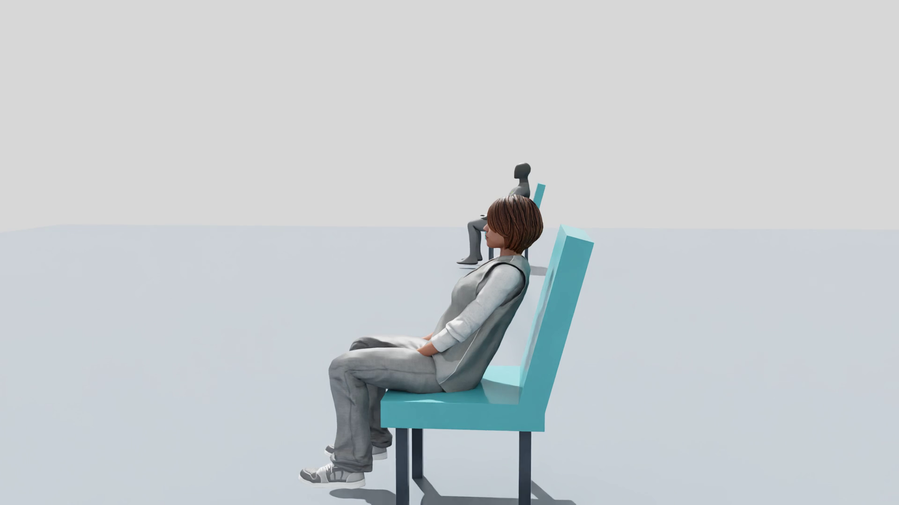

# ROSClaw SimPeople 优化实施报告 · 2026-10-31

编制时间：2026-10-31T07:44:50+08:00。本报告覆盖 1031 优化轮次；v0.1 原始实施报告、失败运行和已封存归档保持原样。

源码工作区提交：`6203ed82ea25f4c8f9dc7c87c90e83743bdf2d6c`。各原生运行实际执行的输入以该运行 `source_snapshot/` 与 `manifest.json` 为准，不能仅用后来提交覆盖原始来源。

## 1. 结论与当前验收状态

| 工作线 | 结果 |
| --- | --- |
| 动作连续性 | 原生/分段/连续通行对照已完成；保留刹车、取消和动态障碍响应。 |
| 座椅匹配 | 12 个基础人物完整坐下/起身通过，进入途中和坐稳后取消通过；头颈顶点检查均未检测到进入靠背。 |
| 插件产品 | 共享 Runtime、Kit 扩展、MCP/CLI、Codex 和 Claude 薄插件已实现；20 个 MCP 工具。 |
| 真实 Codex | 三项自然语言任务经原生事件和状态核对通过。 |
| 真实 Claude | 安装校验和 MCP 连接已通过；未登录，三项自然语言任务未执行。 |
| 50 人新通行回归 | 仍在运行；不能提前计为新版本容量通过。 |

“通过”严格区分动作完成、接触代理测量、顶点穿透检查、人数容量和实时性能。当前仍不宣称完全无滑步、精确全身碰撞、24 FPS 实时人群或任意人物/椅子自动兼容。

## 2. 最终产品定位

ROSClaw SimPeople 是一个让 Agent 在 Isaac Sim 中安排人物和群体活动，并依据真实执行结果继续控制的插件项目。人物逻辑共用一套运行时；Codex 与 Claude Code 的入口只负责工具接入、安装配置与工作流。

| 组件 | 职责 |
| --- | --- |
| Runtime | 原生任务监督、资源占用、通行预约、改令和取消结算。 |
| Kit 扩展 | 附着已有场景，所有 USD/Behavior 写入在主线程执行，管理自有图层。 |
| MCP 与 CLI | 同一控制接口；异步 task_id、批量逐项结果、汇总、分页与事件游标。 |
| 宿主插件 | Codex 可移植 manifest/MCP/Skill；Claude plugin manifest/MCP/Skill。 |

Agent 提交活动后由 Runtime 持续执行。MCP 断开不会删除活动；一个会话同时只有一个逻辑写控制者，其他客户端可观察。该机制协调本机可信客户端，不代替网络认证。

## 3. 滑步排查与连续通行

先实测同一默认人物、相同长直线/转角/走跑切换/终点停止。原生直达与原分段预约的差异，支持了中间子任务反复刹停影响连续性的判断。新增安全走廊预约后，仍使用原生移动与最终刹车，争用时保留保守规划，动态障碍出现时先刹停再重规划。没有靠人物根或骨骼写入掩盖问题。

| 运行 | 移动原生任务数 | 支撑段漂移中位数 cm | p95 cm | 判定 |
| --- | --- | --- | --- | --- |
| opt1031-motion-A-native-02 | 3 | 4.55 | 17.49 | 实际活动成功 |
| opt1031-motion-B-segmented-01 | 14 | 6.31 | 29.67 | 实际活动成功 |
| opt1031-motion-C-corridor-01 | 3 | 6.68 | 19.43 | 原型慢跑速度偏低，已修正 |
| opt1031-motion-CD-corridor-02 | 3 | 4.84 | 14.91 | 实际活动成功 |
| opt1031-motion-CD-lazy-03 | 3 | 5.21 | 15.45 | 实际活动成功 |

修正版本将同一移动序列从 14 个原生移动任务减为 3 个。最后一组通行与动态障碍测试实测成功，记录到障碍刹车事件，未触发持续根重叠或根跳变。支撑段漂移是估计接触的测量，不能直接等同真实滑移量；转身、离地和触地过渡仍会影响尾部分布。

首个连续通行原型将 NavMesh 的大量密集采样点直接交给 move_along，导致慢跑变慢，因此未被当作最终修复。之后以 0.01 m 容差保留端点/转角并压缩采样；等待时缓存候选路径、错开重试，只在需要时验证局部 NavMesh 边。

`连续通行、竞争人物及临时障碍原生结果` (local reference evidence)；`足端代理统计及最差帧号` (local reference evidence)。

[相同仿真时间片段的分段/连续走路并排视频](https://github.com/ros-claw/simpeople/releases/download/demos-20261031/optimization_1031_motion_comparison.mp4)。两侧各为连续真实渲染片段；编码播放速度不代表实际运行吞吐。

## 4. 足端测量与帧身份

用开始时的站立姿态和关节旋转校准后跟/前掌鞋底代理点。接触估计使用高度绝对值 ≤0.025 m、竖直速度绝对值 ≤0.15 m/s、至少 3 个样本及 0.06 s；根平面速度 >0.25 m/s 仅选择移动窗口。没有用脚的水平低速筛选接触，避免把真正滑动的样本排除。

记录实际 SDK 根/关节、原生任务、请求步态和速度、路段与预约状态、仿真时间、墙钟时间、样本与录像帧身份。数据来自实际运行；原生速度单位还用实际根位移核对，没有根据文档文字盲改百倍比例。

| 基础人物 | 接触段数 | 中位漂移 cm | p95 cm | 原生移动任务 |
| --- | --- | --- | --- | --- |
| default | 130 | 4.61 | 19.44 | 2 |
| female_adult_business_02 | 131 | 2.21 | 14.52 | 2 |
| female_adult_medical_01 | 117 | 2.39 | 17.41 | 2 |
| female_adult_police_01 | 124 | 1.96 | 17.89 | 2 |
| female_adult_police_02 | 129 | 2.84 | 17.25 | 2 |
| female_adult_police_03 | 122 | 2.21 | 11.23 | 2 |
| male_adult_construction_01 | 112 | 2.24 | 14.59 | 2 |
| male_adult_construction_02 | 108 | 2.47 | 17.56 | 2 |
| male_adult_construction_03 | 120 | 2.35 | 15.02 | 2 |
| male_adult_construction_05 | 125 | 3.03 | 12.49 | 2 |
| male_adult_medical_01 | 100 | 3.12 | 17.81 | 2 |
| male_adult_police_04 | 114 | 2.22 | 22.61 | 2 |

12 个基础人物均完成 35 m 走、35 m 慢跑、转向和停止。上述统计证明完成与可观察的接触代理表现；没有宣称安装了足端力传感器，也没有为任意速度建立无滑步保证。

`十二人物走跑终态` (local reference evidence)；`十二人物分项测量` (local reference evidence)；[实际走跑展示视频（仿真时间回放）](https://github.com/ros-claw/simpeople/releases/download/demos-20261031/optimization_1031_gait_demo.mp4)。

## 5. 座椅几何、坐姿进入与取消

旧标记下，12 个基础人物的头颈顶点检查都检测到了靠背穿透；侧面实际画面与检测一致。SeatProfile 现在记录座面/深度、Hips 效应器、靠背有向盒、接近与离座点、适配证据和版本。

曾尝试前移 Hips 0.24 m：虽然消除了顶点穿透，但侧面复查发现坐得过于靠前，因此继续修正为自建靠背后倾 15°、Hips 仅前移 0.08 m，保留 0.48 m 座面和 0.6 m 深度。外部用户的椅子资产没有被自动改形。





第一次新匹配试验有 6 人出现坐姿保持失败：较宽的保持容差提前匹配了进入关键帧，随后原生坐姿继续收敛，被误判成对齐丢失。现在只在进入保持前额外要求 Hips 距实际效应器 ≤0.04 m，再满足原有稳定时间；保持期的几何、速度和持续异常阈值保持原值。重跑后十二人物完整周期及两种取消窗口均通过。

| 基础人物 | 精细采样数 | 头颈顶点最小间隙 mm | 检测到进入靠背的帧 |
| --- | --- | --- | --- |
| default | 682 | 74.63 | 0 |
| female_adult_business_02 | 345 | 69.42 | 0 |
| female_adult_medical_01 | 347 | 5.17 | 0 |
| female_adult_police_01 | 349 | 50.22 | 0 |
| female_adult_police_02 | 346 | 46.46 | 0 |
| female_adult_police_03 | 346 | 45.69 | 0 |
| male_adult_construction_01 | 344 | 58.56 | 0 |
| male_adult_construction_02 | 345 | 57.68 | 0 |
| male_adult_construction_03 | 342 | 34.52 | 0 |
| male_adult_construction_05 | 344 | 52.25 | 0 |
| male_adult_police_04 | 798 | 28.74 | 0 |
| male_adult_medical_01 | 343 | 45.06 | 0 |

轻量检查使用头颈球体和胸背胶囊；精细检查用资产蒙皮权重、逆绑定矩阵及实际原生关节姿态重建选定头颈顶点。十二资产绑定姿态的独立数学校验最大距离误差约 4.23×10⁻⁸ m。测试检查的是顶点与靠背的关系，不是逐三角形或全身接触证明。

`完整周期和取消结果` (local reference evidence)；`每个人物精细检查` (local reference evidence)；`该次未剪辑原始录像` (local reference evidence)；[前后静帧对照视频](https://github.com/ros-claw/simpeople/releases/download/demos-20261031/optimization_1031_seat_comparison.mp4)；[十二人物完整坐姿与取消未剪辑录像](https://github.com/ros-claw/simpeople/releases/download/demos-20261031/optimization_1031_seat_lifecycle.mp4)。

## 6. 可查询的能力与验证失效

质量目录已生成 24 项记录：12 个基础人物的走跑测量及 12 个人物与座椅模板的顶点审计。记录绑定资产目录内 USD 层、动作目录 USD、rig、Isaac/Behavior/Navigation 实际版本，以及座椅模板和实际表面/靠背/效应器几何指纹。资源或几何改变后，旧记录不再匹配。

相同几何的材质外观变体可匹配相同源资源记录；没有因此增加“基础人物”数量。坐姿功能 verified 与座椅几何 quality 分开返回。未登记的外部椅子、其他骨骼、其他动作速度范围仍需单独验证。

[质量目录](../configs/quality_catalog.json)；[未来 SimScene 场景交接小协议](../schemas/scene-handoff.schema.json)。

## 7. 帧率、回读和录制成本

同一 30 人/seed 42/1920×1080/分段通行场景，每次 30 墙钟秒预热、120 墙钟秒测量。吞吐测试不启用 Tracy，单次只开一个本轮自有 Kit；机器上其他应用保留，资源日志记录共享负载。因此这些是当前环境的对照结果，不是独占硬件的普适速度保证。

| 运行 | RTF | 实际更新/墙钟秒 | p50 ms | p95 ms | 说明 |
| --- | --- | --- | --- | --- | --- |
| opt1031-perf30-01-full | 0.160 | 4.80 | 160.1 | 413.1 | baseline |
| opt1031-perf30-02-no-encode | 0.239 | 7.18 | 117.7 | 253.1 | baseline |
| opt1031-perf30-03-render-only | 0.319 | 9.57 | 69.2 | 248.9 | 原型：缺活动 RGB 图，不能纯归因 CPU 回读 |
| opt1031-perf30-04-none | 0.372 | 11.18 | 56.5 | 252.2 | baseline |
| opt1031-perf30-05-full | 0.225 | 6.75 | 121.5 | 268.1 | optimized |

恢复完整功能后，RTF 从 0.160 到 0.225，吞吐约提高 40.8%；p95 帧间隔从 413.1 ms 到 268.1 ms。仍未达到 24 实际更新/墙钟秒或 RTF 0.8。

优化包括早期共享姿态缓存、关节索引缓存、保持原判据的根重叠空间筛选、动态障碍边界不变时复用分类，以及将编码线程约束为 4。编码使用 16 帧有界队列，记录提交等待、队列深度、帧身份和关闭时帧数核对；没有静默丢帧。以上是组合优化，不能将全部收益归于一个参数。

第一轮 render_only 只保留 render product 而没有活动 RGB 图，app update 数从 4 变为 1；它作为管线下界保留，不用来声称纯 CPU 回读成本。修正版附加 GPU RGB 图但不读取数据；最终场景复测结果如下。所有已核对条件的仿真步长仍为 1/30 s。

| 最终场景补测 | RTF | 实际更新/墙钟秒 | p95 ms |
| --- | --- | --- | --- |
| opt1031-final30-full-01 | 0.181 | 5.44 | 339.2 |
| opt1031-final30-render-only-01 | 0.213 | 6.41 | 325.9 |
| opt1031-final30-no-encode-01 | 0.186 | 5.58 | 336.5 |

可选 CPU 线程和 Ampere retrace 对照均单列；默认仍为 8 线程及原画质。retrace=0.1 是 NVIDIA 提到的吞吐与光照准确性取舍，不能当作不改画质的纯性能收益。启动时的实际设置写入 runtime_settings.json。

运行模式已提供：interactive 默认 1280×720；generation 默认 1920×1080；audit 开启精细观测；experimental 明确实验用途。模式名称不是人数或实时性能证书；分辨率可显式指定。

## 8. 剖析范围与限制

首个 Tracy 文件有效，但包含约 103 s 启动缓冲，且未记录预期自定义区间，未把其未筛选聚合耗时当作稳定帧瓶颈。已改为显式 Tracy 接口，修正版文件/窗口核对待该轮关闭后填入。

跨线程原生区间会重叠，不能把其聚合时间相加当作墙钟百分比。CSV CPU scope 不等于 GPU 设备执行时间；原始 Tracy 文件保留以供 GPU lane/等待关系复查。剖析轮不用于最终吞吐比较。没有用四张显卡推定四倍加速，也没有未经核对就改时间步、减少人物动作或把低分辨率冒充原画质。

## 9. 两种宿主与真实自然语言验收

| 宿主 | 包/连接 | 自然语言结果 |
| --- | --- | --- |
| Codex CLI 0.166.0 | 可移植 manifest/MCP schema、安装、工具发现与 Skill 校验通过 | 3 项真实任务通过（按原生状态判定） |
| Claude Code 2.1.305 | 隔离 Linux 入口可运行；plugin validate 通过；MCP Connected | 未登录，未执行 3 项自然语言任务。 |

| Codex 项目 | 实际核对 | 完成 MCP 调用 | 含已恢复的工具错误 |
| --- | --- | --- | --- |
| 1 | actor_created; native_life_actions_completed; final_task_succeeded; seat_released | 19 | 1 |
| 2 | three_created; first_two_retargeted; first_two_completed; third_kept_original_wait | 22 | 0 |
| 3 | moving_task_cancelled; restored_wait_completed; actor_stopped; others_kept_tasks | 21 | 0 |

Codex 第一项曾先查询尚未创建的人物能力，收到 ACTOR_NOT_FOUND，之后创建并继续完成；该工具错误保留。批量测试核对前两人的控制版本与终态、第三人的原任务；取消恢复核对被取消的移动、之后成功的等待及其他人物任务未改。三次独立宿主调用使用同一稳定控制者身份，运行时持有任务。

两个宿主均已从公开 GitHub 仓库完成 marketplace/plugin 实际安装。插件提供不同的稳定控制者默认值，断线重连沿用同一逻辑身份；同一宿主的独立实例应配置不同 ID。[公开安装回执](../reports/optimization_1031_plugin_installation.json)。

初次宿主尝试也保留为失败：Codex 没有将父 shell 的自定义端点传给 MCP 子进程，实际连接被拒绝，0 人被创建。修正为显式 MCP env 之后重跑。另对授权验收使用仅针对本机 SimPeople server 的工具审批配置，宿主文件系统仍为只读，没有全局绕过沙箱。

`Codex 终态核对` (local reference evidence)；`宿主版本与设置` (local reference evidence)；`实际输入` (local reference evidence)；[Claude 当前状态](../reports/optimization_1031_claude_status.json)；[宿主安装和环境转发说明](../docs/plugins.md)。

## 10. 人数容量与兼容边界

v0.1 的 50 人三个种子各 600 仿真秒、每人至少 2 周期记录继续保留；队列超时也保持原记录。该证据不被改写成新版本所有动作质量均通过，更不等于 50 人实时。100 人仍仅为探索，原严格位移参与为 89/100。

本轮 `opt1031-regression50-seed17-02` 是新连续通行策略的 50 人 seed 17 /600 仿真秒回归，目前未关闭，尚不能提前计为通过。

首轮新通行长测未通过：274.8 仿真秒时 person_025 连续失败后暂停。共有 8 次排队超时、1 次坐下步骤在接近途中超时、2 次清理 STOP_FAILED。50/50 人有严格位移参与，但最少周期为 0，不能冒充完整容量通过。

修复将 12 人以上的连续通行限制为已完整预约的 12 米步行/18 米慢跑区段，仍在每个区段末端原生刹停，不占住整条跨厂房路线。取消坐下接近时，只有实际站稳并远离所有离座点的包络才直接释放椅子；近椅、坐姿及离座途中继续正常清理。修复后的原生复测单独保存，不改写首轮结果。

首轮长测与宿主控制验证曾同时运行于不同 GPU；它验证功能持续运行，不是独占负载的速度基准。首次受控吞吐对照没有并行启动本轮另一自有 Kit。外部已有 Isaac 应用始终未停止。

`本轮 50 人指标（关闭后生成）` (local reference evidence)；`实际双客户端读写控制权核对` (local reference evidence)。

定点原生回归：远处坐下接近取消在 0.70 仿真秒内结算并释放座位，未返回椅子；13 人实例条件下的有限通道路线实际依次经过两个 via 与最终目标。此前减速未结束就选择 egress 的失败也保留在 cleanup-corridor-13-01。

## 11. 安装、维护与开放源码

```bash
python3 -m pip install -e '.[mcp,assets,video]'
export SIMPEOPLE_ISAAC_DIR=/path/to/isaac-sim
export SIMPEOPLE_CHARACTER_DIR=/path/to/Isaac/People/Characters
python3 scripts/cache_assets.py
simpeople serve --scenario industrial_life --gpu 0 --duration 3600
```

发布采用单独允许列表导出和全新 Git 历史，不把本地原始想法文档、旧私有历史、NVIDIA 模型/动作/纹理、用户凭据或完整运行日志推上公网。代码为 MIT；NVIDIA 资产和第三方依赖遵从各自许可。插件包和共享源码分别验证。

已公开仓库：[ros-claw/simpeople](https://github.com/ros-claw/simpeople)。是否已公开、公开提交及文件校验，以发布清单为准。编辑式源码安装是支持的启动方式；单独 wheel 不包含场景、配置与缓存准备脚本。

## 12. 验证、保留失败与剩余工作

当前代码单元测试覆盖协议、幂等、代际控制、取消资源、批量逐项结果、读分页、事件游标、空间筛选、局部导航边、远处坐下取消与有限通道预约。工作区已通过 73 项测试。该测试数不被当作人物动画验收；人物结论来自前述实际 Kit 运行。

| 保留的尝试 | 问题与处理 |
| --- | --- |
| motion-A-native-01 | 没有及时提交人物活动，空场运行未作为有效动作基线。 |
| motion-C-corridor-01 | 密集 NavMesh 点拖慢慢跑；后续保留转角简化重测。 |
| gait-corridor-12-01 | 首次完整网格预计算引发未知结果超时；按需局部边与相同 request_id 重试后重跑。 |
| seat-calibrated-v3-12-01 | 6 人过早开始保持后发生对齐丢失；进入效应器稳定判据修正，保持阈值不放宽。 |
| host-codex-01 | 端点未转发导致连接拒绝，0 人创建；显式环境配置后新运行通过。 |
| perf30-03 / perf30-06 | 无活动 RGB 图的原型下界、混入启动缓冲的剖析，均未冒充最终稳定成本。 |

剩余边界：Claude 自然语言验收需要本机登录；实时 24 FPS/RTF 0.8 未达；没有精确全身三角形、受力平衡、足端接触力、机器人深度/LiDAR或任意骨骼/椅子自动适配保证。多人移动目标跟随维持原有受限状态。

原生 Behavior API、Tracy 与性能配置依据本机 SDK 绑定和 NVIDIA 官方资料核对：[Behavior API](https://docs.omniverse.nvidia.com/kit/docs/behavior-simulation/latest/behavior-simulation/api.html)、[Tracy 指南](https://docs.isaacsim.omniverse.nvidia.com/6.2.0/utilities/debugging/profiling_performance.html)、[性能手册](https://docs.isaacsim.omniverse.nvidia.com/6.2.0/reference_material/sim_performance_optimization_handbook.html)。宿主格式核对 [OpenAI 插件文档](https://developers.openai.com/plugins/build/plugins) 与 [Claude 插件参考](https://code.claude.com/docs/en/plugins-reference)。
